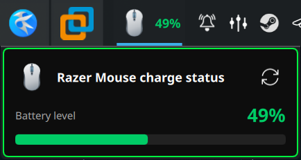

# Razer Battery Level Status Widget [Plasmoid] for KDE 6




The widget displays the mouse’s battery percentage as well as its charging status.

For multi-device setups, use the **Device hint** field in the widget UI so it picks a specific `charge_level` path containing that text. The value is saved and restored automatically.
The widget caches the active device path and automatically re-detects it if the mouse reconnects and the sysfs path changes.
Polling is adaptive: faster while charging, slower on battery, and fast retry when device path is unavailable.

Tested on openSuSE Tumbleweed + KDE 6.6.4

## Install

You must have the openrazer kernel module installed and running before using the widget.

The installation script install.sh does not make any system‑level changes to modules or packages, it only checks certain dependencies and suggests that you fix them manually, after which it copies the widget folder into the KDE environment.

```bash
git clone https://github.com/gddrx/Razer-Battery-Level-Status.git
cd Razer-Battery-Level-Status
chmod +x install.sh
./install.sh
```
## Use

After resolving the dependencies and installing the widget, simply add it to the dock from the widget list.

## Notes

The widget was tested with the **Razer Viper Ultimate** mouse.
If you have many devices, open the widget and enter a stable identifier (for example USB ID fragment) in **Device hint**.
